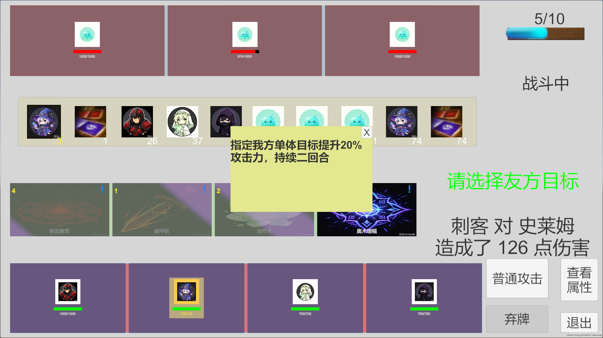
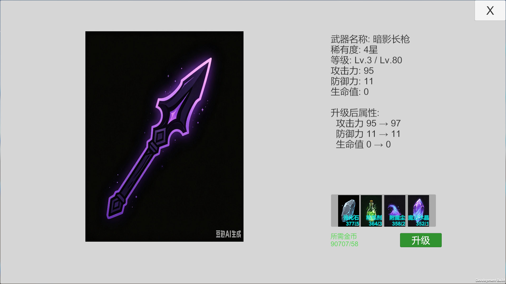
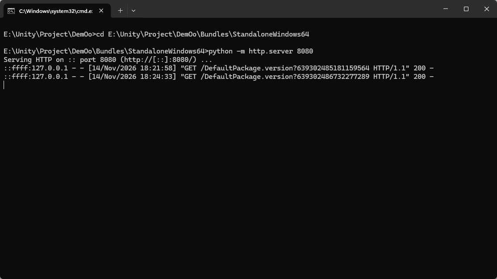

# DemOo


|  |  |  |
|:---:|:---:|:---:|
| 回合制卡牌战斗 | 遗器 / 武器养成 | 热更版本加载 |

## 这是什么

**一款卡牌战斗 + 刷装备养成的回合制游戏 Demo。它真正的卖点不是玩法，而是"改代码不用重新装包"：**

- 游戏逻辑全部放在**热更程序集**里——改一行战斗代码，跑一遍构建脚本，客户端启动时自动拉取新版本，**无需重新打包安装**；
- 养成闭环完整：抽卡 → 背包 → 装备/遗器 → 分解 → 商店 → 副本，一套能跑通的全流程；
- 战斗是回合制卡牌：角色、技能、能量、行动顺序、波次推进，带近战/远程/法球技能表现（移动、挥砍、飞行物、命中特效）。

## 我负责什么

个人独立开发的 Demo：全部玩法系统、热更/资源管线搭建与脚本化、JSON 配置结构设计均由本人完成；使用开源框架 [YokiFrame](https://github.com/HinataYoki/YokiFrame)（UI / 事件 / 资源 / 音频）与 [HybridCLR](https://github.com/focus-creative-games/hybridclr)、[YooAsset](https://github.com/yankooliveport/YooAsset) 两个开源方案。

## 技术难点与解法

### ① HybridCLR 热更管线：让"改代码即生效"真的跑起来

**难点**：C# 是 AOT 编译，iOS/部分平台不允许运行时生成代码；热更程序集与主程序集的边界、AOT 泛型补齐，处理不好就运行时崩溃。
**解法**：程序集二分——`GameLogic`（热更）与 `Shared`（AOT 基线）分离；构建流程脚本化为 **6 步**（Generate → Build → `CopyHotUpdateDlls.bat` → YooAsset 构建 → `UpdateServerManifest.bat` → `StartHttpServer.bat`），改完逻辑代码一键同步到本地资源服务器。

### ② YooAsset 版本管理

**难点**：多版本 bundle、manifest 与实际文件的同步容易错位。
**解法**：`UpdateServerManifest.bat` 自动选择**最新版本目录**，把版本清单、manifest、bundle 一次性同步到 `Bundles/StandaloneWindows64`，客户端启动按版本请求热更加载。

### ③ 养成数值全配置驱动

**难点**：养成类系统数值散落各处，改一次 Lv.1→满级曲线要翻代码。
**解法**：角色/武器/遗器/副本/波次/技能/抽卡全部 JSON 配置（LitJson），属性成长由「Lv.1 值 + 满级值」线性插值生成；遗器主词条按部位规则生成（头=固定生命、手=固定攻击、躯干/脚=随机池），副词条随机 + 强化 + 套装效果。

## 怎么运行

1. Unity **2022.3.62f3c1** 打开项目；
2. 跑一遍热更构建（6 步脚本见 `HybridCLRData/` 与根目录 `.bat`），再运行 `StartHttpServer.bat`；
3. Play——客户端经 YooAsset 从 `http://127.0.0.1:8080` 拉取热更版本后进入游戏。

## 架构说明

`GameLogic`（热更程序集：战斗/数据/UI）与 `Shared`（AOT 主程序集：配置模型/基础管理器）分离；YokiFrame 驱动 UI、事件、资源、音频；全部数值 JSON 配置驱动。

## 后续计划

- [ ] 打包 Windows 演示版（内置资源模式，免本地资源服务器）
- [ ] 战斗表现增强：更多技能表现类型与打击反馈

## 目录结构

<details>
<summary>展开查看</summary>

```text
Assets/
├── DataConfig/                  # JSON 配置（角色/武器/遗器/副本/波次/技能/抽卡等）
├── HotUpdateCodeAssets/         # 热更程序集产物（*.dll.bytes）
├── HybridCLRGenerate/           # HybridCLR AOT 泛型补充与 link.xml
├── Scripts/
│   ├── GameLogic/               # 游戏逻辑（HotUpdate 热更程序集）
│   │   ├── Battle/              # 战斗核心、技能处理、回合、波次
│   │   ├── Data/                # 账户、养成、抽卡、商店等系统
│   │   └── UI/                  # 各 UI 面板
│   ├── Shared/                  # 共享主程序集（AOT）
│   ├── HybridCLR/               # HybridCLR 启动管理
│   └── GameBootstrap.cs         # 启动流程
Bundles/                         # YooAsset 构建输出（不入库）
HybridCLRData/                   # HybridCLR 构建输出（不入库）
```

</details>

> ⚠️ 修改 `Shared` 程序集（如新增配置字段/类型）后，需要重新 Build Player 作为新基线——仅更新 `HotUpdate.dll` 无法修复 AOT 主程序集变更。
